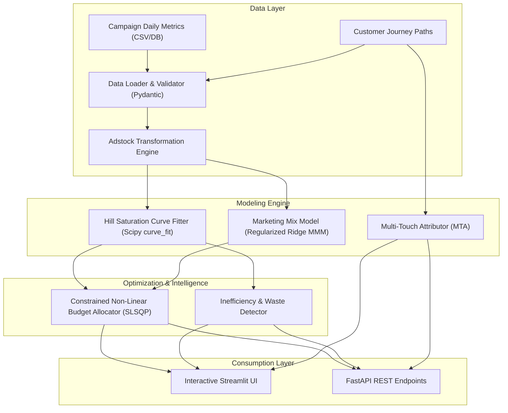
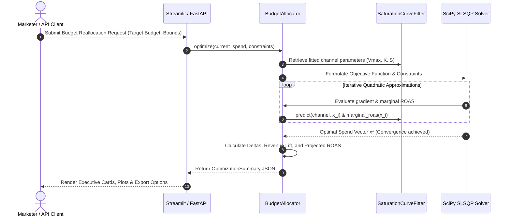

# Technical Deep Dive: Marketing Budget Optimizer

A rigorous mathematical and architectural breakdown of the algorithms, data models, and optimization mechanisms powering the Marketing Budget Optimizer.

---

## 1. System Architecture

The following diagram illustrates the end-to-end data processing and optimization architecture:

---

## 2. Mathematical Formulations

### 2.1 Diminishing Marginal Returns & Saturation Modeling

In advertising economics, response curves exhibit diminishing marginal returns: initial expenditures build reach and conversions rapidly, but continued spending encounters audience exhaustion and rising marginal bid costs.

We model this response using the **Hill Saturation Function** (widely recognized in pharmacology and Marketing Mix Modeling):

$$R(x) = V_{\max} \cdot \frac{x^S}{K^S + x^S}$$

Where:
- $x$: Daily ad spend on the channel ($x \ge 0$).
- $V_{\max}$: Asymptotic maximum revenue capacity achievable by the channel.
- $K$: Half-saturation parameter ($R(K) = \frac{1}{2} V_{\max}$).
- $S$: Hill shape / slope parameter:
  - If $S > 1$, the response exhibits an S-curve (inflection threshold required before acceleration).
  - If $S \le 1$, the response is strictly concave from $x = 0$.

#### Marginal Return on Ad Spend (mROAS)
The marginal return represents the instantaneous rate of change of revenue with respect to spend, derived as the first derivative:

$$\frac{dR}{dx} = V_{\max} \cdot S \cdot K^S \cdot \frac{x^{S-1}}{(K^S + x^S)^2}$$

The point where $\frac{dR}{dx} = 1.0$ is the **economic breakeven knee**: any additional dollar spent beyond this threshold yields less than \$1.00 in incremental revenue, producing net economic loss.

---

### 2.2 Adstock Carryover Effect Modeling

Advertising impact does not terminate on the day an ad impression is served; it persists in consumer memory (adstock carryover).

#### Geometric (Exponential) Decay
The standard geometric carryover is formulated as:

$$A_t = X_t + \theta \cdot A_{t-1}$$

Where:
- $X_t$: Spend or impression volume on day $t$.
- $A_t$: Adstocked effective marketing pressure on day $t$.
- $\theta \in [0, 1)$: Retention parameter (decay rate). A higher $\theta$ indicates longer consumer memory (e.g., brand awareness and influencer sponsorships).

#### Weibull Decay (Delayed Peak)
For campaigns with delayed conversion lifecycles (such as influencer partnerships or video awareness), we employ a Weibull weighting distribution:

$$w_t = \frac{\gamma}{\lambda} \left( \frac{t}{\lambda} \right)^{\gamma - 1} e^{-(t/\lambda)^\gamma}, \quad t \in \{1, \dots, L\}$$

Where $\gamma$ controls the shape (delay of the peak) and $\lambda$ controls the scale (decay rate).

---

### 2.3 Constrained Non-Linear Budget Optimization

#### Problem Formulation
We formulate budget reallocation as a non-linear programming problem under equality and inequality constraints:

$$\max_{\mathbf{x}} \quad \Phi(\mathbf{x}) = \sum_{i=1}^M R_i(x_i)$$

Subject to:

$$\sum_{i=1}^M x_i = B_{\text{target}} \quad (\text{Budget Equality Constraint})$$

$$L_i \le x_i \le U_i \quad \forall i \in \{1, \dots, M\} \quad (\text{Box Constraints})$$

Where:
- $\mathbf{x} = [x_1, x_2, \dots, x_M]^T$: Spend vector across $M$ marketing channels.
- $R_i(x_i)$: Fitted revenue response function for channel $i$.
- $B_{\text{target}}$: Total marketing capital allocated.
- $L_i, U_i$: Lower and upper spend bounds for channel $i$, computed as:
  $$L_i = x_{i,\text{curr}} \cdot (1 - \delta_{\max}), \quad U_i = x_{i,\text{curr}} \cdot (1 + \delta_{\max})$$
  with $\delta_{\max} \in (0, 1]$ representing the user-configured maximum swing percentage.

#### Optimality Condition: The Equimarginal Principle
Under the Karush-Kuhn-Tucker (KKT) conditions for Lagrangian optimization:

$$\mathcal{L}(\mathbf{x}, \lambda, \boldsymbol{\mu}_L, \boldsymbol{\mu}_U) = -\sum_{i=1}^M R_i(x_i) + \lambda \left(\sum_{i=1}^M x_i - B_{\text{target}}\right) + \sum_{i=1}^M \mu_{L,i}(L_i - x_i) + \sum_{i=1}^M \mu_{U,i}(x_i - U_i)$$

For all unconstrained channels ($L_i < x_i^* < U_i$), optimal allocation requires:

$$\frac{dR_1}{dx_1}(x_1^*) = \frac{dR_2}{dx_2}(x_2^*) = \dots = \frac{dR_k}{dx_k}(x_k^*) = \lambda^*$$

The **Marginal ROAS must be equalized across all channels**. If channel $A$ exhibits higher marginal ROAS than channel $B$, transferring \$1 from $B$ to $A$ strictly increases total portfolio revenue without altering total spend.

#### Numerical Solver
The system solves this using **Sequential Least Squares Programming (SLSQP)** via `scipy.optimize.minimize`, chosen for its quadratic convergence properties and robust handling of non-linear equality and inequality constraints.

---

### 2.4 Multi-Touch Attribution Formulations

For a customer conversion journey consisting of $N$ sequential touchpoints at timestamps $t_1, t_2, \dots, t_N$ with total conversion value $V$:

1. **First-Touch:**
   $$w_1 = 1.0, \quad w_j = 0.0 \; (\forall j > 1)$$

2. **Last-Touch:**
   $$w_N = 1.0, \quad w_j = 0.0 \; (\forall j < N)$$

3. **Linear:**
   $$w_j = \frac{1}{N} \quad \forall j \in \{1, \dots, N\}$$

4. **Time-Decay:**
   $$w_j = \frac{2^{-(t_N - t_j)/\tau}}{\sum_{k=1}^N 2^{-(t_N - t_k)/\tau}}$$
   where $\tau$ represents the half-life parameter (default: 7 days).

5. **Position-Based (U-Shaped 40-20-40):**
   $$w_1 = 0.40, \quad w_N = 0.40, \quad w_j = \frac{0.20}{N - 2} \; (\forall j \in \{2, \dots, N-1\})$$

---

## 3. Optimization Pipeline Execution

The sequence below illustrates a budget optimization request cycle:

---

## 4. Algorithmic Complexity & Performance

- **Curve Fitting:** $\mathcal{O}(M \cdot K_{\text{iter}})$, where $M$ is the number of channels and $K_{\text{iter}}$ is the bounded Levenberg-Marquardt / Trust Region iterations. Execution time: $< 50\text{ ms}$ for typical marketing datasets.
- **SLSQP Optimization:** $\mathcal{O}(M^2 \cdot I)$, where $I \le 100$ iterations. Average execution time: $< 35\text{ ms}$.
- **Attribution Processing:** Vectorized Pandas operations process 50,000+ touchpoint paths in $< 1.2\text{ seconds}$.

